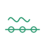
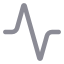

#  Abstract-Mindfreak · AM-Core

AM-Core is a local workbench for finding published audio-production parameters, reviewing their values, and carrying retrieval results into session and macro workflows. Audio, text, and spectrogram-oriented modes use separate retrieval paths and indexes; results can be reviewed and adjusted in the UI.

The published parameter library in **Parameter Catalogue** is the product’s parameter authority. **Service Bay** reports and rebuilds indexes derived from that library. **AM-Stage** is the session workbench that consumes those indexes. A generated corpus or index is not the catalogue itself.

## Modes

| Mode | What it does |
|---|---|
|  [AM-Core Dashboard](docs/modes/am-core-dashboard.md) | Entry point and navigation to the main work areas. |
|  [AM Tri-Modal Stage](docs/modes/am-stage.md) | Work with a session audio file, text search, segmented analysis, parameter banks, timeline and exports. |
|  [AM-Core Engine](docs/modes/am-core-engine.md) | Search parameters by text or transition, adjust retrieved controls and prepare macro output. |
|  [Service Bay](docs/modes/service-bay.md) | Inspect index coverage and run manual index maintenance. |
|  [Audio-to-Parameter](docs/modes/audio-to-parameter.md) | Create time-based nodes and inspect audio-derived parameter results. |
|  [Audio CLAP RAG](docs/modes/audio-clap-rag.md) | Retrieve parameter candidates from an audio query with CLAP. |
|  [Morpho-Acoustic RAG](docs/modes/morpho-acoustic-rag.md) | Retrieve parameter candidates from an image or spectrogram with SigLIP2. |
|  [AM-Vocal Morphology Matrix](docs/modes/am-vocal-morphology-matrix.md) | Search and review vocal-related parameters from a structured description. |
|  [Combinatorial Genesis](docs/modes/combinatorial-genesis.md) | Inspect and process candidate material and runtime atoms. |
|  [Combinatorial Synthesis](docs/modes/combinatorial-synthesis.md) | Propose, review and publish parameter combinations from selected sources and a semantic goal. |
|  [Parameter Catalogue](docs/modes/parameter-catalogue.md) | Browse, maintain, import and export the published parameter library. |
|  [Settings](docs/modes/settings.md) | Configure language, appearance, model slots and feature/bank availability. |
|  [White Space Discovery](docs/modes/research-modes.md#white-space-discovery) | Explore sparse regions of the published catalogue. |
|  [Knowledge Graph](docs/modes/research-modes.md#knowledge-graph) | Build and inspect parameter relations and neighbors. |
|  [Cross-Modal Consensus](docs/modes/research-modes.md#cross-modal-consensus) | Review cross-modal journal records and run consensus/transition operations. |

The sidebar also groups legacy tools under **Archive / Legacy & Research**; their individual SVG icons are shown on the [legacy mode card](docs/modes/legacy-research.md).

| Legacy mode | |
|---|---|
|  AM-Crystal Library ·  Semantic Plane ·  IRE |  Metis Lab ·  Metis Research |
|  GW-Collapser ·  GW Crystal Pool ·  Torus Atlas |  Map · Crystal UMAP ·  Meta-Crystal V3 Lab |

## AM-Stage banks

Text retrieval keeps separate Qwen and EmbeddingGemma 2 banks so results from different encoders are not merged into one bank. The visible bank IDs are `text.qwen.resolved` and `text.gemma.awtd`; Gemma text value-pass results use `text.gemma.resolved`. Audio banks include `audio.clap.resolved`, `audio.gemma.awtd` and `audio.gemma.resolved`. SigLIP2 spectrogram results use `spec.siglip.resolved`. The `spec.gemma.*` capability is disabled by default.

In Stage terminology, **AWTD** expands to *Axis / Weight / Threshold / Depth* and denotes the parameter identity/role pass that retains catalogue defaults. **Resolved** denotes a later value pass; actual values may come from a retrieval/anchor result or a catalogue fallback. These names describe distinct banks and should not be treated as interchangeable.

## Quick start

Requirements: Node.js compatible with the repository’s Next.js version, pnpm, Python, and a running Ollama service for enabled Ollama-backed features. Model weights, local CLAP/SigLIP2 assets and generated indexes are not bundled.

```powershell
pnpm install
python -m pip install -r requirements.txt
pnpm run db:generate
pnpm run db:push
pnpm run dev
```

Open [http://localhost:3000](http://localhost:3000). Select model IDs and enable the required capabilities in **Settings**. The default embedding slots are Qwen `qwen3-embedding:0.6b` and EmbeddingGemma 2 `embeddinggemma-2:740m`; settings can override them. Install the selected Ollama models separately and ensure the configured local CLAP/SigLIP2 assets are available before using those modes. Python jobs are started by the application as needed; there is no separate Python sidecar service to launch.

## Architecture

```text
Next.js / React UI → Next.js API routes and TypeScript jobs → Python sidecar / local model runtimes → catalogue-derived indexes and analysis artifacts
```

The application uses Ollama for configured embedding and language-model slots and local runtimes for CLAP, SigLIP2 and acoustic feature processing. Indexes are built from catalogue data in **Service Bay**; sessions and work modes consume the indexes relevant to their configured model and modality.

## Models and licenses

Configured model families include Qwen embeddings, EmbeddingGemma 2, LAION-CLAP, SigLIP2, optional LFM3 audio, and Ollama language models. Exact IDs, providers and enablement are configurable in Settings. Respect the license and usage terms of each upstream model and dataset.

## Documentation

- [Mode cards](docs/modes/)
- [MMSS mode catalog](docs/mmss-modes/abstract-mindfreak-modes-catalog.mmss.json)
- [AM-Stage MMSS contract](docs/mmss-modes/am-tri-modal-stage.mmss.json)
- [Service Bay index matrix](docs/service-bay-index-matrix.md)
