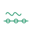
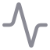

#  Abstract-Mindfreak · AM-Core

AM-Core — локальная рабочая среда для поиска опубликованных аудиопараметров, проверки их значений и переноса результатов поиска в сценарии работы с сессией и макросами. Режимы используют отдельные пути поиска и индексы для текста, аудио и спектрограмм; результаты можно просматривать и корректировать в интерфейсе.

Авторитетный источник параметров продукта — опубликованная библиотека в **Каталоге параметров**. **Service Bay** показывает состояние и перестраивает производные индексы. **AM-Stage** использует эти индексы как рабочая среда сессии. Сгенерированный корпус или индекс не заменяет каталог.

## Режимы

| Режим | Назначение |
|---|---|
|  [AM-Core Dashboard](docs/modes/am-core-dashboard.ru.md) | Стартовая страница и переходы к основным режимам. |
|  [AM Tri-Modal Stage](docs/modes/am-stage.ru.md) | Работа с аудиосессией, текстовым поиском, сегментным анализом, банками параметров, временной шкалой и экспортом. |
|  [AM-Core Engine](docs/modes/am-core-engine.ru.md) | Поиск параметров по тексту или переходу, настройка результатов и подготовка макроса. |
|  [Service Bay](docs/modes/service-bay.ru.md) | Проверка покрытия индексов и ручное обслуживание. |
|  [Audio-to-Parameter](docs/modes/audio-to-parameter.ru.md) | Создание временных узлов и просмотр результатов анализа аудио. |
|  [Audio CLAP RAG](docs/modes/audio-clap-rag.ru.md) | Поиск кандидатов параметров по аудиозапросу с CLAP. |
|  [Morpho-Acoustic RAG](docs/modes/morpho-acoustic-rag.ru.md) | Поиск кандидатов по изображению или спектрограмме через SigLIP2. |
|  [AM-Vocal Morphology Matrix](docs/modes/am-vocal-morphology-matrix.ru.md) | Поиск и проверка вокальных параметров по структурированному описанию. |
|  [Combinatorial Genesis](docs/modes/combinatorial-genesis.ru.md) | Проверка и обработка кандидатных материалов и runtime atoms. |
|  [Combinatorial Synthesis](docs/modes/combinatorial-synthesis.ru.md) | Создание, проверка и публикация комбинаций параметров из выбранных источников и смысловой цели. |
|  [Каталог параметров](docs/modes/parameter-catalogue.ru.md) | Просмотр, обслуживание, импорт и экспорт опубликованной библиотеки параметров. |
|  [Настройки](docs/modes/settings.ru.md) | Настройка языка, оформления, слотов моделей и доступности функций/банков. |
|  [White Space Discovery](docs/modes/research-modes.ru.md#white-space-discovery) | Анализ разреженных областей опубликованного каталога. |
|  [Knowledge Graph](docs/modes/research-modes.ru.md#knowledge-graph) | Построение и просмотр связей параметров. |
|  [Cross-Modal Consensus](docs/modes/research-modes.ru.md#cross-modal-consensus) | Просмотр мультимодальных journal-записей и операции consensus/transition. |

В сайдбаре инструменты прежнего контура собраны в группе **Архив / Legacy & Research**; отдельные SVG-иконки каждого пункта показаны в [карточке legacy-режимов](docs/modes/legacy-research.ru.md).

| Legacy-режим | |
|---|---|
|  Библиотека AM-Crystal ·  Semantic Plane ·  IRE |  Metis Lab ·  Metis Research |
|  GW-Collapser ·  GW Crystal Pool ·  Torus Atlas |  Map · Crystal UMAP ·  Meta-Crystal V3 Lab |

## Банки AM-Stage

Текстовые результаты Qwen и EmbeddingGemma 2 хранятся в отдельных банках: `text.qwen.resolved` и `text.gemma.awtd`. Результаты прохода Gemma по значениям используют `text.gemma.resolved`. Аудиобанки: `audio.clap.resolved`, `audio.gemma.awtd` и `audio.gemma.resolved`. Результаты спектрограмм SigLIP2 используют `spec.siglip.resolved`. Возможность `spec.gemma.*` по умолчанию выключена.

В терминологии Stage **AWTD** означает *Axis / Weight / Threshold / Depth* и обозначает проход идентификации параметров/их ролей с сохранением каталожных defaults. **Resolved** — отдельный проход по значениям; конкретные значения могут поступать из поиска/anchors или использовать fallback каталога. Эти названия относятся к разным банкам и не взаимозаменяемы.

## Быстрый запуск

Требуются Node.js, совместимый с версией Next.js проекта, pnpm, Python и запущенный Ollama для включённых функций на Ollama. Веса моделей, локальные ресурсы CLAP/SigLIP2 и построенные индексы в репозиторий не входят.

```powershell
pnpm install
python -m pip install -r requirements.txt
pnpm run db:generate
pnpm run db:push
pnpm run dev
```

Откройте [http://localhost:3000](http://localhost:3000). Выберите идентификаторы моделей и включите нужные функции в **Настройках**. Модели embedding по умолчанию: Qwen `qwen3-embedding:0.6b` и EmbeddingGemma 2 `embeddinggemma-2:740m`; настройки позволяют выбрать другие. Установите выбранные Ollama-модели отдельно и проверьте доступность локальных CLAP/SigLIP2 ресурсов. Python-задачи запускает приложение по запросу; отдельный Python-сервис запускать не нужно.

## Архитектура

```text
Интерфейс Next.js / React → API-маршруты Next.js и TypeScript-задачи → Python sidecar / локальные runtime моделей → индексы и артефакты анализа на основе каталога
```

Для настроенных слотов embedding и языковых моделей приложение использует Ollama; CLAP, SigLIP2 и обработка акустических признаков запускаются локальными средствами. Индексы строятся на основе данных каталога через **Service Bay**; рабочие режимы используют индексы своей модели и модальности.

## Модели и лицензии

В конфигурации предусмотрены семейства Qwen embeddings, EmbeddingGemma 2, LAION-CLAP, SigLIP2, опциональный LFM3 Audio и языковые модели Ollama. Точные ID, провайдеры и доступность настраиваются в Настройках. Соблюдайте лицензии и условия использования каждой исходной модели и набора данных.

## Документация

- [Карточки режимов](docs/modes/)
- [Каталог режимов MMSS](docs/mmss-modes/abstract-mindfreak-modes-catalog.mmss.json)
- [Контракт AM-Stage MMSS](docs/mmss-modes/am-tri-modal-stage.mmss.json)
- [Матрица индексов Service Bay](docs/service-bay-index-matrix.md)
