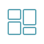
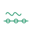
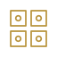
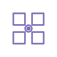
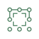
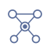
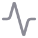

# Mode cards · Карточки режимов

Short descriptions of the modes exposed by the primary sidebar, plus the separate legacy group. The feature inventory is grounded in `Sidebar.tsx`, `AppShell.tsx`, `PageRenderer.tsx` and the corresponding page components.

| Mode | English | Русский |
|---|---|---|
| Mode | English | Русский |
|---|---|---|
|  Dashboard | [AM-Core Dashboard](am-core-dashboard.md) | [AM-Core Dashboard](am-core-dashboard.ru.md) |
|  AM-Stage | [AM Tri-Modal Stage](am-stage.md) | [AM Tri-Modal Stage](am-stage.ru.md) |
|  Engine | [AM-Core Engine](am-core-engine.md) | [AM-Core Engine](am-core-engine.ru.md) |
|  Index maintenance | [Service Bay](service-bay.md) | [Service Bay](service-bay.ru.md) |
|  Audio analysis | [Audio-to-Parameter](audio-to-parameter.md) | [Audio-to-Parameter](audio-to-parameter.ru.md) |
|  Audio retrieval | [Audio CLAP RAG](audio-clap-rag.md) | [Audio CLAP RAG](audio-clap-rag.ru.md) |
|  Image retrieval | [Morpho-Acoustic RAG](morpho-acoustic-rag.md) | [Morpho-Acoustic RAG](morpho-acoustic-rag.ru.md) |
|  Vocal matrix | [AM-Vocal Morphology Matrix](am-vocal-morphology-matrix.md) | [AM-Vocal Morphology Matrix](am-vocal-morphology-matrix.ru.md) |
|   Combinatorial work | [Genesis](combinatorial-genesis.md) · [Synthesis](combinatorial-synthesis.md) | [Genesis](combinatorial-genesis.ru.md) · [Synthesis](combinatorial-synthesis.ru.md) |
|  Catalogue | [Parameter Catalogue](parameter-catalogue.md) | [Каталог параметров](parameter-catalogue.ru.md) |
|  Settings | [Settings](settings.md) | [Настройки](settings.ru.md) |
|    Research modes | [White Space · Knowledge Graph · Cross-Modal](research-modes.md) | [White Space · Knowledge Graph · Cross-Modal](research-modes.ru.md) |
|           Legacy group | [Archive / Legacy & Research](legacy-research.md) | [Архив / Legacy & Research](legacy-research.ru.md) |

[Main README](../../README.md) · [README на русском](../../README.ru.md)
