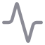

# Archive / Legacy & Research

The sidebar groups these earlier or specialized tools separately from the primary AM-Core workflow:

-  AM-Crystal Library,  Semantic Plane and  IRE.
-  Metis Lab and  Metis Research.
-  GW-Collapser,  GW Crystal Pool and  Torus Atlas.
-  Map · Crystal UMAP and  Meta-Crystal V3 Lab.

The group is retained for existing workflows; it is not the parameter-catalogue authority.

[← Main README](../../README.md) · [RU](legacy-research.ru.md)
