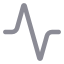

# Архив / Legacy & Research

В сайдбаре эти прежние или специализированные инструменты сгруппированы отдельно от основного рабочего процесса AM-Core:

-  Библиотека AM-Crystal,  Semantic Plane и  IRE.
-  Metis Lab и  Metis Research.
-  GW-Collapser,  GW Crystal Pool и  Torus Atlas.
-  Map · Crystal UMAP и  Meta-Crystal V3 Lab.

Группа оставлена для существующих сценариев; она не является авторитетным источником каталога параметров.

[← README](../../README.ru.md) · [EN](legacy-research.md)
